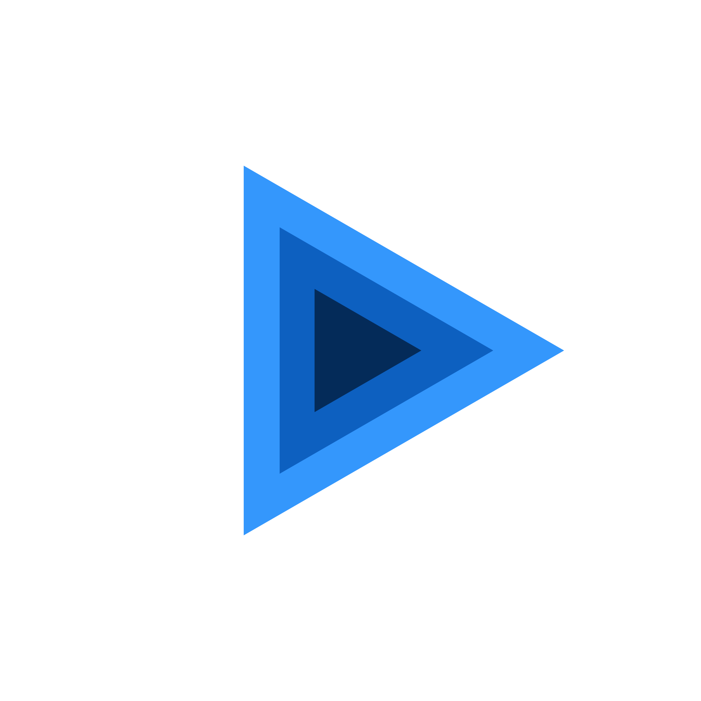
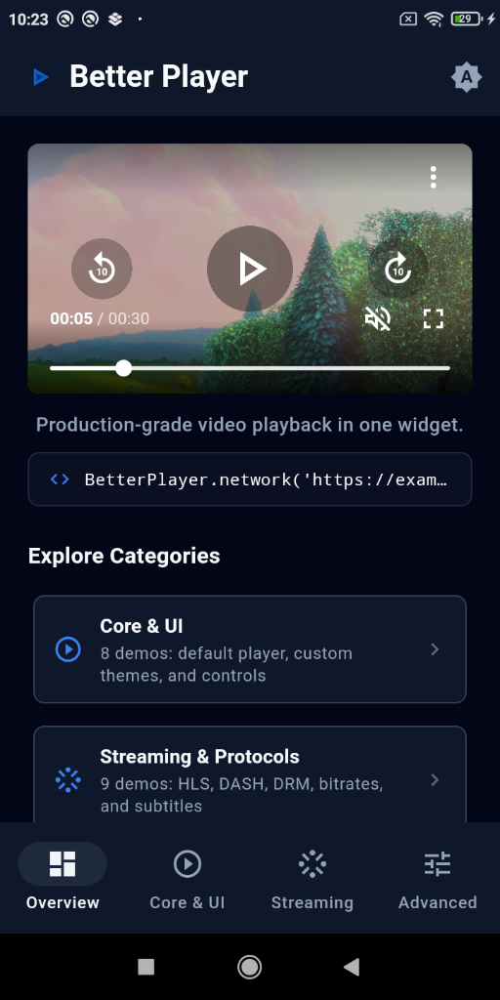
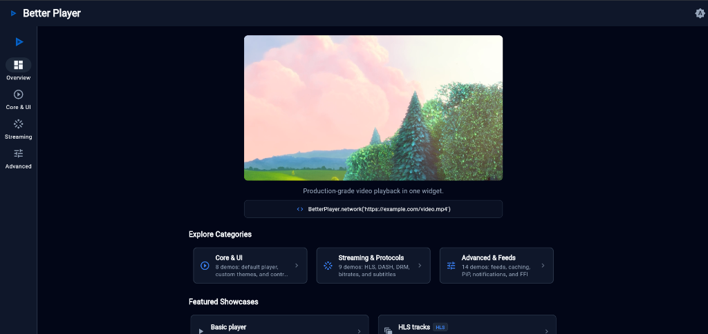

  

# Better Player

Better Player is an advanced video player plugin for Flutter, built upon the foundation of [Chewie](https://github.com/fluttercommunity/chewie). It enhances the original concepts by addressing common bugs, providing extensive configuration options, and offering solutions for advanced video playback use cases.

## Key Features

Better Player provides a robust set of features designed for production-ready applications:

*   **Reliability**: Fixes for common bugs found in other players.
*   **Advanced Configuration**: Granular control over player behavior and appearance.
*   **Refactored Controls**: Modern, customizable user interface.
*   **Playlist Support**: Play sequences of videos continuously.
*   **ListView Integration**: Optimized for video playback within scrollable lists.
*   **Comprehensive Subtitles**: Support for SRT and WebVTT formats (with HTML tags), HLS segmented subtitles, and multiple subtitle tracks.
*   **Adaptive Streaming**: Full support for HLS and DASH, including track, subtitle, and audio track selection.
*   **Performance & Optimization**: Integrated cache support and alternative resolution selection.
*   **Advanced Capabilities**: Support for Picture-in-Picture (PiP), DRM (Token, Widevine, FairPlay EZDRM), and custom HTTP headers.
*   **Platform Features**: Native notifications and comprehensive BoxFit support.
*   **macOS Support**: Dedicated desktop playback powered by native AVPlayer, AppKitView, and FFI bindings.
*   **Windows Support**: Desktop playback powered by libmpv and Direct3D 11 texture sharing.
*   **Web Support**: Advanced web playback using Shaka Player for HLS, DASH, and DRM.
*   ... and much more! See the detailed [Platform Support](platform_support.md) matrix.

## Important Information

:::important
Better Player is currently under active development. While we aim for stability, breaking changes may occur between versions.
:::

This plugin is developed as a community-driven project. If you require a feature that is currently missing or supported by other players on pub.dev, we highly encourage you to submit a Pull Request. All valuable contributions are welcome!

## Screenshots

| Mobile Overview | Native Picture-in-Picture (PiP) |
|:---:|:---:|
|  |  |

| Web & Desktop Overview | Touch & Fullscreen Controls |
|:---:|:---:|
|  |  |

| Adaptive HLS Quality & Track Switching | Styled Subtitles (WebVTT / TTML / SRT) |
|:---:|:---:|
|  |  |
