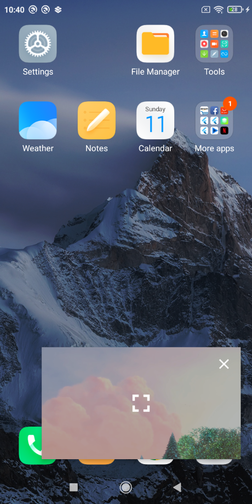
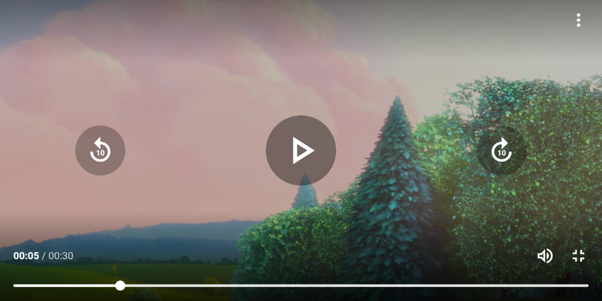
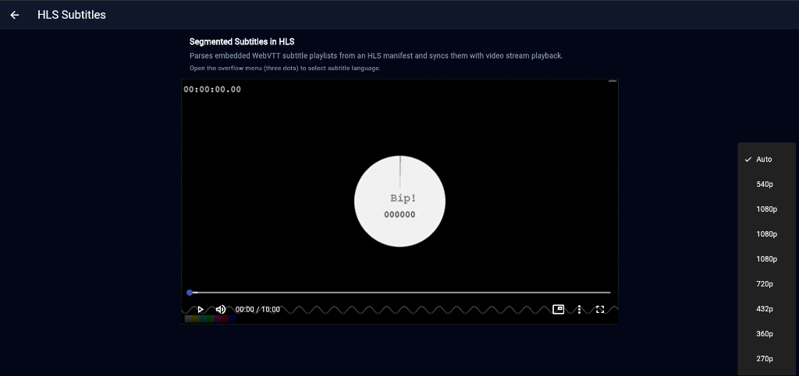
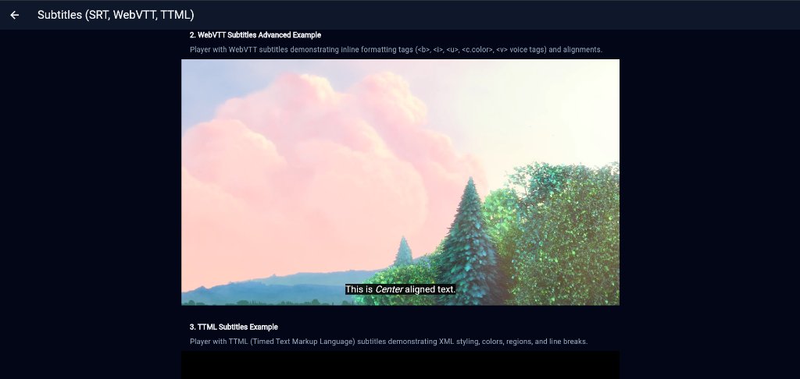

<p align="center">
  
</p>

# Better Player

<p align="center">
  <b>The complete, production-grade video player for Flutter.</b><br>
  One unified controller. Native performance. Zero bloated binaries.
</p>

<p align="center">
  <a href="https://pub.dev/packages/better_player"></a>
  <a href="https://pub.dev/packages/better_player/score"></a>
  <a href="https://pub.dev/packages/better_player/score"></a>
  <a href="https://github.com/jhomlala/betterplayer"></a>
  <a href="https://github.com/jhomlala/betterplayer/blob/master/LICENSE"></a>
</p>

<p align="center">
  <a href="https://jhomlala.github.io/betterplayer/"><b>Documentation</b></a> &bull;
  <a href="https://jhomlala.github.io/betterplayer/migration_from_video_player"><b>Migrating from video_player</b></a> &bull;
  <a href="https://jhomlala.github.io/betterplayer/migration_from_chewie"><b>Migrating from chewie</b></a> &bull;
  <a href="https://github.com/jhomlala/betterplayer/tree/master/packages/better_player_example"><b>Example App</b></a>
</p>

---

## Why Better Player?

Stop stitching `video_player`, separate UI packages, abandoned caching plugins, and custom DRM code together. Better Player packs the full video stack into a single, cohesive engine.

| Feature | Better Player | video_player + chewie | media_kit |
|---|:---:|:---:|:---:|
| **App Size Overhead** | **~1-2 MB** (Native OS engines) | ~1-2 MB | **+30MB to 50MB** (Bundled mpv binaries) |
| **Out-of-the-box UI** | Built-in & customizable | Chewie required | Built-in |
| **HLS / DASH** | Full native support | Basic | Native |
| **DRM (Widevine / FairPlay)** | Native support | None | None |
| **Smart Caching** | Built-in offline cache | None (3rd party needed) | None |
| **Subtitles** | SRT, WebVTT, TTML | SRT only | Advanced |
| **Picture in Picture (PiP)** | Built-in | None | Platform-dependent |
| **Playlists** | Built-in | None | Built-in |
| **VAST / VMAP Ads** | Client-side ad engine (VAST 2.0-4.x, VMAP) | None | None |
| **Video Feeds & Pooling** | Built-in (`BetterPlayerFeed`, `BetterPlayerPool`) | None | None |

---

## 📱 Visual Showcase

<table align="center">
  <tr>
    <td align="center" width="50%">
      <br>
      <b>Mobile Overview</b>
    </td>
    <td align="center" width="50%">
      <br>
      <b>Native Picture-in-Picture (PiP)</b>
    </td>
  </tr>
  <tr>
    <td align="center" width="50%">
      <br>
      <b>Web & Desktop Overview</b>
    </td>
    <td align="center" width="50%">
      <br>
      <b>Touch & Fullscreen Controls</b>
    </td>
  </tr>
  <tr>
    <td align="center" width="50%">
      <br>
      <b>Adaptive HLS Quality & Track Switching</b>
    </td>
    <td align="center" width="50%">
      <br>
      <b>Styled Subtitles (WebVTT, TTML, SRT)</b>
    </td>
  </tr>
</table>

---

## 📦 Quick Start

### 1. Install
```bash
flutter pub add better_player
```

### 2. Basic Playback
Play a network video with full controls in three lines:

```dart
import 'package:better_player/better_player.dart';

AspectRatio(
  aspectRatio: 16 / 9,
  child: BetterPlayer.network(
    "https://commondatastorage.googleapis.com/gtv-videos-bucket/sample/BigBuckBunny.mp4",
  ),
)
```

### 3. Production Playback (Caching, DRM & HLS)
Configure caching, custom headers, or DRM with a single controller:

```dart
final controller = BetterPlayerController(
  const PlayerConfiguration(
    aspectRatio: 16 / 9,
    autoPlay: true,
  ),
  betterPlayerDataSource: PlayerDataSource(
    DataSourceType.network,
    "https://example.com/stream.m3u8",
    // Cache video locally for instant playback:
    cacheConfiguration: const CacheConfiguration(useCache: true),
    // Or protect content with DRM:
    drmConfiguration: DrmConfiguration(
      drmType: DrmType.widevine,
      licenseUrl: "https://license.example.com",
    ),
  ),
);

BetterPlayer(controller: controller);
```

### 4. High-Performance Video Feeds (TikTok / Reels)
Render infinite vertical or horizontal swipe feeds using bounded controller pooling and lookahead preloading:

```dart
BetterPlayerFeed(
  controller: BetterPlayerFeedController(
    dataSources: feedSources,
    poolConfiguration: const PlayerPoolConfiguration(
      poolSize: 3,
      preloadForward: 1,
      preloadBackward: 1,
    ),
  ),
);
```

---

## 🌐 Platform Packages

Better Player uses a federated architecture. Each platform runs on its native, hardware-accelerated media engine:

| Platform | Package | Engine | Status |
|---|---|---|:---:|
| **Android** | `better_player_android` | Google Media3 / ExoPlayer | [](https://pub.dev/packages/better_player_android) |
| **iOS** | `better_player_ios` | Apple AVPlayer | [](https://pub.dev/packages/better_player_ios) |
| **macOS** | `better_player_macos` | Apple AVPlayer | [](https://pub.dev/packages/better_player_macos) |
| **Web** | `better_player_web` | Shaka Player / HTML5 | [](https://pub.dev/packages/better_player_web) |
| **Windows** | `better_player_windows` | libmpv | [](https://pub.dev/packages/better_player_windows) |

---

## 🔄 Migration Guides

Switching from another package? Follow the step-by-step migration guides:

- [Migrating from video_player](https://jhomlala.github.io/betterplayer/migration_from_video_player): Replace `VideoPlayerController` and remove separate UI packages.
- [Migrating from chewie](https://jhomlala.github.io/betterplayer/migration_from_chewie): Consolidate your player and controls into a single controller.

---

## 🤖 AI Coding Agents

Better Player supports [Dart package skills](https://dart.dev/ai/package-skills) so tools like Cursor, Claude Code, Gemini, and Copilot understand the API out of the box:

```bash
dart run skills@ get -p better_player
```

---

## 📖 Resources & Docs

- [Official Documentation](https://jhomlala.github.io/betterplayer/): Full guides for caching, DRM, subtitles, VAST ads, and playlists.
- [Example Application](https://github.com/jhomlala/betterplayer/tree/master/packages/better_player_example): Complete working samples covering every feature.
- [API Reference](https://pub.dev/documentation/better_player/latest/): Generated Dart doc reference.

---

## 🤝 Contributing

Found a bug or missing a feature? Open an issue or submit a pull request.

## 💼 Enterprise Support

Need a custom video source adapter, bespoke DRM implementation, or tailored UI controls? I am available for consulting.

[Contact on LinkedIn →](https://pl.linkedin.com/in/jhomlala)
