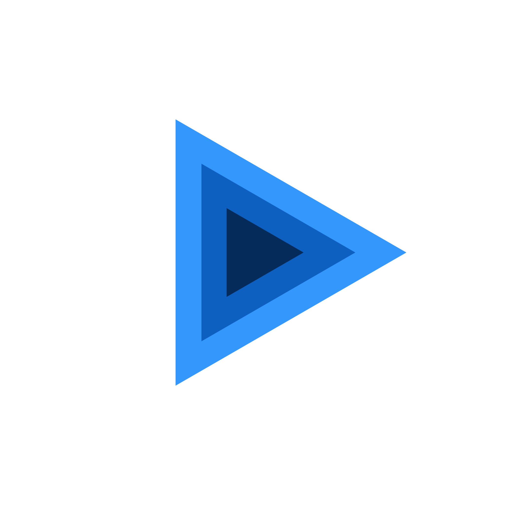

<p align="center">
  
</p>

# better_player_tizen (EXPERIMENTAL)

> **WARNING: THIS PACKAGE IS EXPERIMENTAL.**
> It provides only basic playback capabilities for Samsung Smart TVs and Tizen devices via the native Tizen Multimedia Player API (`<player.h>`). Expect missing features, sharp edges, and breaking changes. Do not rely on this in production without thorough testing on your target Tizen hardware.

Tizen implementation of the [better_player](https://pub.dev/packages/better_player) plugin.

## Usage

This package is an experimental federated plugin implementation. Include `better_player` and `better_player_tizen` in your project:

```yaml
dependencies:
  better_player: ^1.37.0
  better_player_tizen: ^1.0.0
```

## Requirements

* **Tizen SDK**: Tizen 6.0+ (`iot-headed` or `tv-samsung` profile).
* **flutter-tizen**: Configured with Tizen Studio CLI and certificate profile.

### Manifest Privileges

Add these privileges to your `tizen/tizen-manifest.xml` to play network streams or local media files:

```xml
<privileges>
    <privilege>http://tizen.org/privilege/internet</privilege>
    <privilege>http://tizen.org/privilege/mediastorage</privilege>
    <privilege>http://tizen.org/privilege/externalstorage</privilege>
</privileges>
```

## Features (EXPERIMENTAL)

What works right now:
* Basic network (`http`/`https`) and local file playback via `<player.h>`.
* Video rendering via Flutter's `PixelBufferTexture` (`media_packet_video_frame_decoded_cb`).
* Core controls: play, pause, seek, volume, playback speed, and looping.
* Playback events: `initialized`, `completed`, `bufferingUpdate`, `isPlayingStateUpdate`.

What is NOT supported yet:
* DRM protection (Widevine, PlayReady, FairPlay, ClearKey).
* Offline caching and pre-caching (`preCache`, `clearCache`, `stopPreCache`).
* Picture-in-Picture (PiP) mode.
* Native subtitle track extraction and audio track switching.
* Hardware-accelerated zero-copy GPU surface sharing (currently uses CPU pixel buffer copy).
